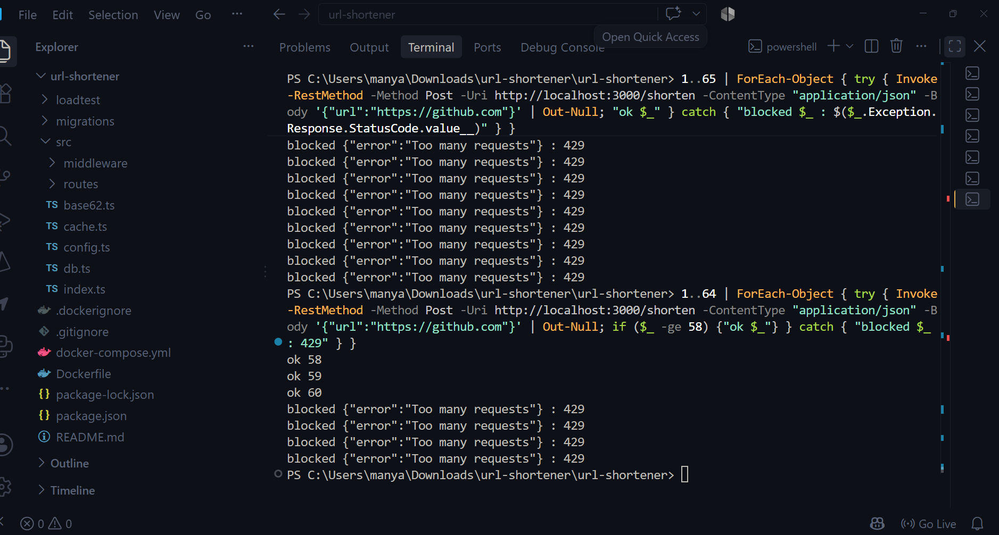

# URL Shortener

A URL shortener built for read-heavy traffic: PostgreSQL for storage, Redis for caching and rate limiting, load tested with k6.

**Stack:** Node.js · TypeScript · Express · PostgreSQL · Redis · Docker Compose · k6

## Architecture

```
Client ──► Express API ──► Redis (cache-aside, rate limit counters)
                │
                └──────────► PostgreSQL (source of truth)
```

- `POST /shorten`: validates the URL, inserts a row, base62-encodes the row ID as the short code.
- `GET /:code`: checks Redis first, falls back to Postgres on a miss, then repopulates Redis. Returns `302`.
- Rate limiting: fixed window per IP in Redis (`INCR` + `EXPIRE`), fails open if Redis is down.

## Design decisions

| Decision | Why |
|---|---|
| Base62 of DB ID instead of random strings | Unique by construction, no collision checks or retries |
| IDs start at 62^5 | Every code is at least 6 characters |
| 7 char codes | 62^7 ≈ 3.5 trillion possible URLs |
| Cache-aside, 24h TTL | Reads dominate writes, hot links stay in memory |
| `302` instead of `301` | Browsers do not cache the redirect forever, links can change |
| Rate limiter fails open | A cache outage should not take the API down |

## Capacity math

- Assume 100M redirects/day: ~1,150 req/s average, ~5,000 req/s at peak.
- Read:write ratio ~100:1, so one Postgres cannot serve every redirect. Cache is required.
- Storage: ~500 bytes per row x 100M rows ≈ 50 GB.

## Run locally

```bash
docker compose up --build
curl -X POST localhost:3000/shorten -H "Content-Type: application/json" -d '{"url":"https://github.com"}'
curl -i localhost:3000/<code>
```

## Load test results

**Setup:** Windows laptop with 8 GB RAM and a ~3.5 GHz CPU. k6, the app, Redis and Postgres all ran on this one machine inside Docker Desktop, so they competed for the same CPU and memory (RAM usage was ~94% during testing). Because of that, run-to-run noise is large. Test data: 1000 short links, 80% of traffic on the hottest 20%, 30 second runs. `http_req_failed` was 0% in every run.

### Cache OFF vs ON (1 app process)

| Target RPS | Cache | Median | p95 | Dropped iterations |
|---|---|---|---|---|
| 1,000 | OFF | 837 ms | 2.36 s | 6,526 |
| 1,000 | ON | 14 ms | 147 ms | 216 |
| 2,000 | OFF | 737 ms | 1.21 s | 27,987 |
| 2,000 | ON | 131 ms | 374 ms | 11,152 |

At 1,000 req/s the cache cut median latency ~60x and p95 ~16x. Without the cache, Postgres saturated at roughly 800-900 req/s and requests queued up.

### Sustainable load (cache ON)

At 500 to 1,200 req/s the median stayed at 2-6 ms with ~1% dropped iterations. p95 varied between ~50 and ~150 ms across runs. On this machine ~1,000 req/s is the practical ceiling, and 2,000 req/s overloaded it.

### Bottleneck analysis

- `docker stats` during the 2,000 req/s test showed the single Node process at ~105% CPU (one core saturated) while Postgres sat at ~7% and Redis at ~9%. The cache was working, the app process was the limit.
- I added Node cluster mode (`WORKERS` env var). On this laptop it did **not** improve throughput: 2 and 4 workers performed about the same as 1 worker, and 4 workers was slightly worse at 2,000 req/s. k6 itself used ~115% CPU, so workers just competed for cores.
- I did not reach 5,000 req/s on this hardware and am not claiming it. That would need the load generator on a separate machine.

### Rate limiter

`POST /shorten` is limited to 60 requests per minute per IP. Request 61 returns `429`:



## Config (env vars)

| Var | Default | Meaning |
|---|---|---|
| `CACHE_ENABLED` | `true` | Turn the Redis cache on/off |
| `CACHE_TTL` | `86400` | Cache TTL in seconds |
| `WORKERS` | `min(cpus, 4)` | Node cluster workers (compose sets 1) |
| `PG_POOL_SIZE` | `20` | Postgres pool size per worker |
| `RATE_LIMIT_SHORTEN` | `60` | Requests/min/IP on `POST /shorten` |
| `RATE_LIMIT_REDIRECT` | `0` | Requests/min/IP on redirects (0 = off) |

For load tests set `RATE_LIMIT_SHORTEN` high (e.g. 5000), because the k6 setup creates 1000 links from one IP.

## Future work

- Token bucket / sliding window limiter (shared with a distributed rate limiter project)
- Click analytics via Redis counters flushed to Postgres in batches
- Custom aliases and link expiry
- Re-run cluster mode and higher RPS tests with k6 on a separate machine